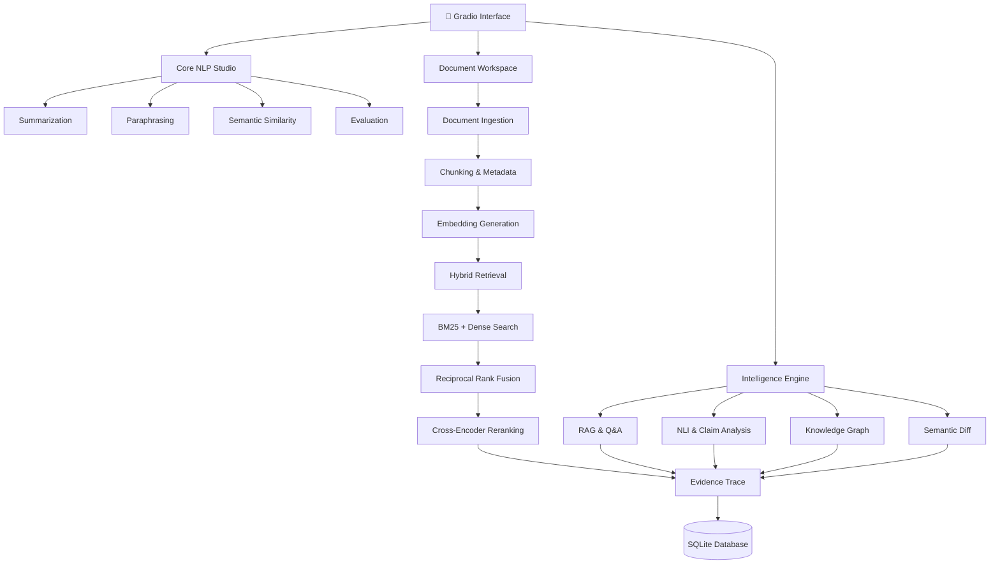

<div align="center">
 
# ✨ TextMorph
 
### Words, reimagined.
 
**An NLP Studio & Document Intelligence Platform**
 
Transform text. Discover meaning. Connect information. Understand documents.
 
<br>
 


 
<br>
 
**From a single sentence to an entire library of documents.**
 
</div>
 
---
 
## 🪄 What is TextMorph?
 
Ever wished you could summarize a massive document, rewrite an awkward paragraph, compare two pieces of text, and actually *ask questions* about your documents?
 
That's the idea behind **TextMorph**.
 
TextMorph started as an NLP toolkit for summarization, paraphrasing and semantic similarity. It has evolved into a modular **Document Intelligence Platform** that combines transformer-based language models, semantic search, hybrid retrieval and evidence-grounded analysis.
 
Instead of just processing words, TextMorph helps you understand what those words actually mean.
 
<details>
<summary>💡 The idea behind the project</summary>
 
Traditional NLP tools usually solve one problem at a time. TextMorph brings multiple language-processing and document-analysis capabilities into one workspace.
 
The goal is to make document exploration more interactive, explainable and useful, while keeping the processing local by default.
 
</details>
 
---
 
## 🎨 Explore TextMorph
 
<div align="center">
 
| ✍️ Summarize | 🔄 Paraphrase |
|:---:|:---:|
| Turn lengthy text into concise summaries. | Rewrite sentences without losing their meaning. |
| 🧠 Compare Meaning | 📊 Evaluate |
| Measure semantic similarity between texts. | Evaluate generated summaries using ROUGE. |
 
</div>
 
### 🧩 The Document Intelligence Workspace
 
The real fun begins when multiple documents enter the picture.
 
| Feature | What it does |
|:---|:---|
| 📚 **Document Workspace** | Upload, organize and manage document collections. |
| 💬 **Ask Documents** | Ask questions and receive answers grounded in retrieved passages. |
| ⚖️ **Find Conflicts** | Identify potentially contradictory claims across documents. |
| 🕸️ **Knowledge Graph** | Discover entities and relationships between concepts. |
| 🔍 **Compare Versions** | Find changes in meaning between document versions. |
| 🎯 **Verify Claims** | Check whether a claim is supported by your documents. |
 
---
 
## 🚀 Features
 
### ✍️ 01. Core NLP Studio
 
Your everyday text-processing toolkit, powered by transformer models.
 
**Summarization**
- Abstractive summarization using DistilBART and T5-small.
- Token-aware document splitting.
- Hierarchical summarization for long inputs.
- Configurable summary generation.
 
**Paraphrasing**
- T5-based paraphrase generation.
- Multiple distinct outputs with duplicate filtering.
- Support for short sentences.
- Best-effort writing styles: Standard, Formal, Simple English, Academic and Creative.
 
**Semantic Similarity**
- Sentence-BERT embeddings using `all-MiniLM-L6-v2`.
- Cosine similarity scoring.
- Sentence-level semantic comparison.
- Similarity matrices and heatmap visualization.
 
**Evaluation**
- ROUGE-1, ROUGE-2 and ROUGE-L.
- Precision, recall and F1 scores.
- Evaluation against user-provided reference summaries.
 
**Text Analytics**
- Word, character, sentence and paragraph counts.
- Average sentence length.
- Estimated reading time.
- Flesch Reading Ease.
- Flesch-Kincaid Grade Level.
 
---
 
### 📚 02. Document Workspace
 
**Your documents. One organized workspace.**
 
- Upload PDF, DOCX and TXT files.
- Create and manage named document collections.
- Detect duplicate files using SHA-256 fingerprints.
- Extract text while preserving available page and paragraph metadata.
- Split documents into overlapping chunks.
- Generate and store document embeddings.
- View document processing status and collection statistics.
- Remove documents and rebuild indexes.
 
<details>
<summary>⚙️ Default ingestion configuration</summary>
 
| Setting | Default |
|:---|---:|
| Maximum file size | 25 MB |
| Documents per collection | 20 |
| Chunk size | 450 tokens |
| Chunk overlap | 80 tokens |
| Maximum chunks per collection | 20,000 |
 
All limits and chunking settings can be configured through environment variables.
 
</details>
 
---
 
### 💬 03. Ask Documents
 
**Because reading every single page is not always the best use of a human lifespan.**
 
Ask questions across an entire document collection and retrieve passages that support the answer.
 
TextMorph uses a Retrieval-Augmented Generation (RAG) pipeline:
 
```text
        Your Question
              |
              v
       Query Embedding
              |
       +------+------+
       |             |
       v             v
   BM25 Search   Dense Search
       |             |
       +------+------+
              |
              v
       Reciprocal Rank
          Fusion
              |
              v
       Cross-Encoder
         Reranking
              |
              v
       Evidence Selection
              |
              v
        Answer Generation
              |
              v
       Verified Citations
```
 
**Answer generation options**
 
- 📄 Extractive mode: returns relevant passages without generative inference.
- 🦙 Ollama: optional local generation using `qwen2.5:3b`.
- 🤖 FLAN-T5: optional generation using `google/flan-t5-base`.
 
Every retrieved passage retains its document name, page number, chunk ID and source text.
 
Citations are assembled and validated using stored metadata rather than trusting a language model to invent references. A surprisingly important distinction.
 
---
 
### ⚖️ 04. Find Conflicts & Verify Claims
 
**When two documents disagree, TextMorph helps you investigate.**
 
Using Natural Language Inference (NLI), TextMorph examines relationships between claims found across documents.
 
Capabilities:
 
- Candidate factual sentence extraction.
- Semantic matching of potentially related claims.
- Entailment, contradiction and neutral classification.
- Numerical discrepancy detection.
- Cross-document conflict reporting.
- Evidence-backed claim verification.
 
Claims are classified as:
 
| Classification | Meaning |
|:---|:---|
| 🟢 Supported | Relevant document evidence supports the claim. |
| 🔴 Contradicted | Relevant evidence conflicts with the claim. |
| 🟡 Insufficient Evidence | The collection does not provide enough information. |
 
Numerical differences are reported separately rather than automatically classified as contradictions.
 
*Note: This is document-grounded verification, not universal fact-checking.*
 
---
 
### 🕸️ 05. Knowledge Graph
 
**Turn disconnected documents into connected information.**
 
TextMorph extracts entities and relationships to build an evidence-backed knowledge graph.
 
Features:
- Entity extraction using spaCy.
- Dependency-based relationship extraction.
- Graph construction using NetworkX.
- Interactive visualization using PyVis.
- Entity and relationship filtering.
- Identification of frequently occurring and highly connected entities.
- Graph export.
 
Supported entity categories include people, organizations, technologies, algorithms, datasets, metrics and research concepts.
 
Relationships retain source evidence and document references. Simple co-occurrence is distinguished from explicitly extracted relationships.
 
---
 
### 🔍 06. Semantic Document Comparison
 
**Not every important change is visible in a traditional diff.**
 
Compare two document versions to identify changes in meaning, not just differences in characters.
 
The pipeline includes:
- Sentence segmentation.
- Sentence embedding generation.
- Semantic sentence alignment.
- Bipartite matching.
- Numerical claim comparison.
- NLI-based meaning analysis.
 
Changes are classified as:
 
| Change | Description |
|:---|:---|
| 🟢 Unchanged | Meaning remains consistent. |
| 🔵 Reworded | Wording changes, meaning stays similar. |
| 🟣 Added | New information appears. |
| 🔴 Removed | Previous information disappears. |
| 🟠 Meaning Modified | The meaning has changed. |
| ⚠️ Potentially Contradictory | The revised content may conflict with the original. |
 
Original and revised passages are displayed alongside similarity scores and source locations.
 
---
 
### 📈 07. Retrieval Evaluation
 
Because an intelligent system should be evaluated, not simply declared intelligent.
 
TextMorph evaluates retrieval quality using user-provided relevant chunk IDs.
 
| Metric | Purpose |
|:---|:---|
| Recall@5 / Recall@10 | Measures relevant chunks retrieved. |
| Precision@5 / Precision@10 | Measures relevance among retrieved chunks. |
| MRR | Measures the position of the first relevant result. |
| nDCG | Measures ranking quality. |
 
Scores are calculated using supplied relevance labels. No imaginary benchmark scores are included.
 
---
 
### 📦 08. Export & Persistence
 
- Export results in TXT, JSON and DOCX.
- CSV export where appropriate.
- Persistent SQLite storage.
- SQLAlchemy data models.
- Stored document collections, chunks and embeddings.
- Evidence records and analysis history.
- Collection-scoped retrieval.
 
**Local-first by default.** Your documents stay on your machine unless you deliberately deploy or expose the application elsewhere.
 
---
 
## 🏗️ Under the Hood
 
TextMorph follows a modular architecture that separates the interface, NLP processing, document ingestion, retrieval and intelligence services.
 

 
### 🗂️ Project Structure
 
```text
TextMorph/
│
├── app.py
├── requirements.txt
├── requirements-optional.txt
├── requirements-dev.txt
├── README.md
│
├── textmorph/
│   ├── config.py
│   ├── documents.py
│   ├── evaluation.py
│   ├── exports.py
│   ├── intelligence.py
│   ├── knowledge_graph.py
│   ├── nlp.py
│   ├── retrieval.py
│   ├── storage.py
│   └── ui.py
│
├── tests/
│
└── data/
    ├── collections/
    ├── exports/
    └── metadata.sqlite
```
 
 
---
 
## 🧠 Models & Technologies
 
<details>
<summary>🤖 Pretrained Models</summary>
 
| Task | Model |
|:---|:---|
| Summarization | `sshleifer/distilbart-cnn-12-6` |
| Summarization | `t5-small` |
| Paraphrasing | `Vamsi/T5_Paraphrase_Paws` |
| Semantic Similarity | `sentence-transformers/all-MiniLM-L6-v2` |
| Dense Retrieval | `sentence-transformers/multi-qa-mpnet-base-dot-v1` |
| Reranking | `cross-encoder/ms-marco-MiniLM-L6-v2` |
| NLI Analysis | `cross-encoder/nli-deberta-base` |
| Optional Answer Generation | `qwen2.5:3b` via Ollama |
| Optional Answer Generation | `google/flan-t5-base` |
 
Models are loaded lazily to reduce unnecessary memory consumption.
 
</details>
 
<details>
<summary>🛠️ Technology Stack</summary>
 
| Category | Technologies |
|:---|:---|
| Language | Python |
| Interface | Gradio |
| Deep Learning | PyTorch |
| NLP | Hugging Face Transformers |
| Embeddings | Sentence-Transformers |
| Similarity | scikit-learn, NumPy |
| Keyword Retrieval | BM25 |
| Vector Search | NumPy cosine-similarity adapter |
| Reranking | Cross-Encoder |
| NLI | DeBERTa |
| Knowledge Graph | spaCy, NetworkX, PyVis |
| Database | SQLite, SQLAlchemy |
| Document Processing | pypdf, python-docx |
| Evaluation | ROUGE, custom retrieval metrics |
| Visualization | Matplotlib |
 
</details>
 
 
 
---
 
## 👀 Take a Look Inside TextMorph
 
<div align="center">
 
### Your workspace, reimagined.
 
Explore the interface where NLP tools and document intelligence come together.
 
<br>
 
<table>
  <tr>
    <td align="center" width="50%">
      
      <br><br>
      <strong>✨ The NLP Studio</strong>
      <br>
      <sub>Summarization, paraphrasing and semantic analysis.</sub>
    </td>
    <td align="center" width="50%">
      
      <br><br>
      <strong>🧠 Document Intelligence</strong>
      <br>
      <sub>Explore documents and uncover meaningful insights.</sub>
    </td>
  </tr>
</table>
 
<br>
 
*Less scrolling through documents. More understanding what's inside them.*
 
</div>
 
---
 
